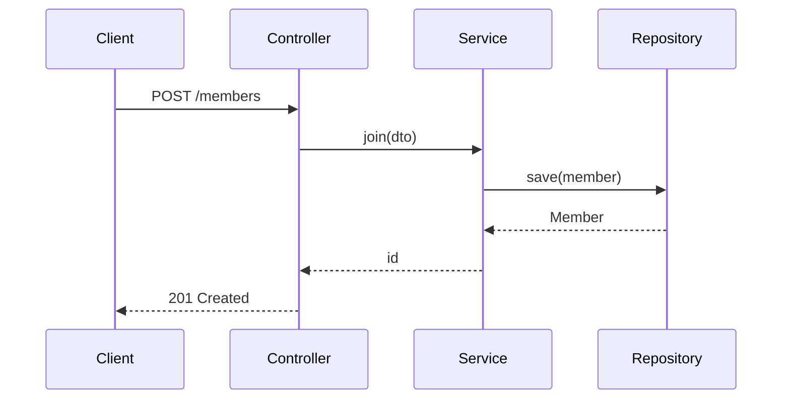
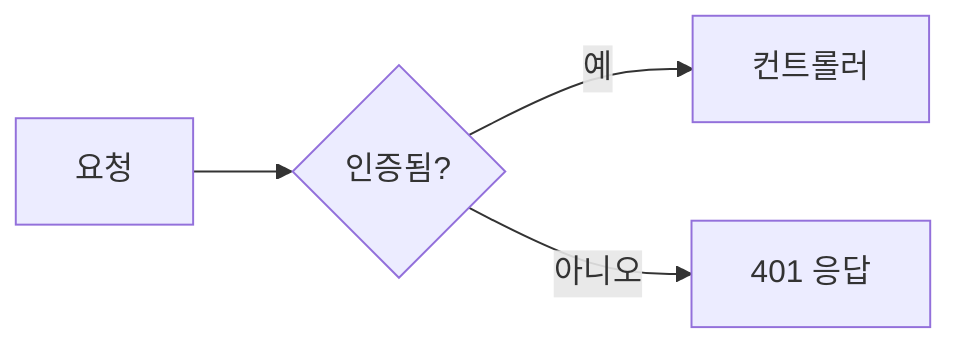
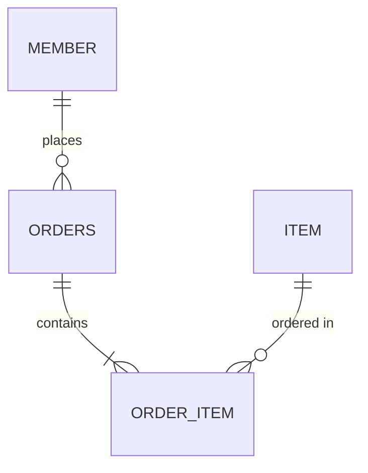

이 글은 블로그에서 지원하는 문법을 모두 모아둔 레퍼런스입니다. 각 항목마다 **작성법**과 **결과**를 같이 보여줍니다.

## 텍스트 서식

```md
**굵게**, *기울임*, ***굵게+기울임***, ~~취소선~~, `인라인 코드`, ==형광펜==
<u>밑줄</u>, H<sub>2</sub>O, x<sup>2</sup>, <kbd>Ctrl</kbd> + <kbd>C</kbd>
```

**굵게**, *기울임*, ***굵게+기울임***, ~~취소선~~, `인라인 코드`, ==형광펜==
<u>밑줄</u>, H<sub>2</sub>O, x<sup>2</sup>, <kbd>Ctrl</kbd> + <kbd>C</kbd>

이모지 단축코드도 됩니다: `:rocket: :white_check_mark: :warning:` → :rocket: :white_check_mark: :warning:

## 제목

`##` 부터 `####` 까지는 오른쪽 목차(On this page)에 자동으로 표시됩니다. `#` 은 글 제목으로 쓰이므로 본문에서는 `##` 부터 사용하세요.

### 3단계 제목

#### 4단계 제목

## 링크와 이미지

```md
[외부 링크](https://astro.build)
<https://github.com> 처럼 꺾쇠로 감싸거나 https://github.com 처럼 그냥 써도 링크가 됩니다.


```

[외부 링크](https://astro.build)
<https://github.com> 처럼 꺾쇠로 감싸거나 <https://github.com> 처럼 그냥 써도 링크가 됩니다.


글 파일 기준 **상대경로**로 넣은 이미지는 빌드할 때 자동으로 WebP 변환·최적화됩니다.

따옴표로 제목을 붙이면 이미지 아래 **캡션**으로 표시됩니다.

```md

```


크기를 지정하고 싶으면 HTML `` 를 씁니다. 이때는 외부 URL 이나 `public/` 폴더의 파일을 사용합니다(HTML 태그 안의 상대경로 이미지는 최적화 대상이 아님).

```html

```

## 목록

```md
- 순서 없는 목록
  - 들여쓰기로 중첩
    - 더 깊게
1. 순서 있는 목록
2. 두 번째

- [x] 완료한 일
- [ ] 아직 안 한 일
```

- 순서 없는 목록
  - 들여쓰기로 중첩
    - 더 깊게

1. 순서 있는 목록
2. 두 번째

- [x] 완료한 일
- [ ] 아직 안 한 일

## 인용과 콜아웃

일반 인용문:

> 인용문입니다.
> 여러 줄도 됩니다.

GitHub / Obsidian 스타일 콜아웃(Notion 의 콜아웃 블록)을 지원합니다.

```md
> [!NOTE]
> 참고 내용

> [!TIP] 제목을 직접 지정할 수도 있어요
> 팁 내용

> [!WARNING]- 접힌 상태로 시작하는 콜아웃
> `-` 를 붙이면 접혀 있고, `+` 를 붙이면 펼쳐진 상태로 접기 가능
```

> [!NOTE]
> 참고 내용

> [!TIP] 제목을 직접 지정할 수도 있어요
> 팁 내용

> [!IMPORTANT]
> 중요한 내용

> [!WARNING]
> 경고 내용

> [!CAUTION]
> 주의 내용

> [!WARNING]- 접힌 상태로 시작하는 콜아웃
> `-` 를 붙이면 접혀 있고, `+` 를 붙이면 펼쳐진 상태로 접기 가능

그 밖에 `abstract`, `info`, `todo`, `success`, `question`, `failure`, `danger`, `bug`, `example`, `quote` 타입도 쓸 수 있습니다.

> [!example] 예시
> 콜아웃 안에서도 **모든 마크다운**과 코드가 동작합니다.
>
> ```java
> System.out.println("hello");
> ```

## 토글 (접기/펼치기)

Notion 의 토글 블록은 HTML `<details>` 로 씁니다. 안쪽에 마크다운을 쓰려면 태그 앞뒤로 **빈 줄**을 두세요.

```md
<details>
<summary>클릭해서 펼치기</summary>

숨겨진 내용입니다. **마크다운**도 됩니다.

</details>
```

<details>
<summary>클릭해서 펼치기</summary>

숨겨진 내용입니다. **마크다운**도 됩니다.

```sql
SELECT * FROM member WHERE id = 1;
```

</details>

## 코드 블록

언어를 지정하면 문법 강조가 되고, 복사 버튼이 자동으로 붙습니다.

````md
```java title="MemberService.java" {3} showLineNumbers
@Service
public class MemberService {
    private final MemberRepository memberRepository;

    public Member findById(Long id) {
        return memberRepository.findById(id).orElseThrow();
    }
}
```
````

```java title="MemberService.java" {3} showLineNumbers
@Service
public class MemberService {
    private final MemberRepository memberRepository;

    public Member findById(Long id) {
        return memberRepository.findById(id).orElseThrow();
    }
}
```

| 옵션      | 예시                   | 설명           |
| ------- | -------------------- | ------------ |
| 파일명     | `title="App.java"`   | 상단에 파일 탭 표시  |
| 줄 강조    | `{1,3-5}`            | 해당 줄 배경 강조   |
| 추가/삭제 줄 | `ins={2} del={3}`    | 초록/빨강 표시     |
| 단어 강조   | `"findById"`         | 해당 단어 강조     |
| 줄 번호    | `showLineNumbers`    | 줄 번호 표시      |
| 시작 줄 번호 | `startLineNumber=10` | 줄 번호 시작값     |
| 접기      | `collapse={1-5}`     | 해당 줄을 접어서 표시 |
| 줄바꿈     | `wrap`               | 긴 줄 자동 줄바꿈   |

추가/삭제 표시:

````md
```yaml ins={3} del={2}
spring:
  datasource-url: old
  datasource.url: jdbc:mysql://localhost:3306/app
```
````

```yaml ins={3} del={2}
spring:
  datasource-url: old
  datasource.url: jdbc:mysql://localhost:3306/app
```

`diff` 언어로도 쓸 수 있습니다.

```diff
- private final MemberRepository repository;
+ private final MemberRepository memberRepository;
```

단어 강조와 접기:

```java "orElseThrow" collapse={1-3}
import java.util.Optional;
import org.springframework.stereotype.Service;
import lombok.RequiredArgsConstructor;

Member member = memberRepository.findById(id).orElseThrow();
```

`bash`, `sh`, `powershell` 은 터미널 창 모양으로 표시됩니다.

```bash
./gradlew clean build
docker compose up -d
```

## 표

```md
| 왼쪽 정렬 | 가운데 정렬 | 오른쪽 정렬 |
| :--- | :---: | ---: |
| A | B | C |
```

| 왼쪽 정렬            | 가운데 정렬 | 오른쪽 정렬 |
| :--------------- | :----: | -----: |
| `@Transactional` |  트랜잭션  |      1 |
| `@Service`       | 서비스 계층 |      2 |

셀 병합 같은 복잡한 표는 HTML `<table>` 로 직접 작성하면 됩니다.

<table>
  <thead><tr><th>격리 수준</th><th>Dirty Read</th><th>Non-Repeatable Read</th><th>Phantom Read</th></tr></thead>
  <tbody>
    <tr><td>READ UNCOMMITTED</td><td>O</td><td>O</td><td>O</td></tr>
    <tr><td>READ COMMITTED</td><td>X</td><td>O</td><td>O</td></tr>
    <tr><td>REPEATABLE READ</td><td>X</td><td>X</td><td rowspan="2">O (InnoDB는 대부분 X)</td></tr>
    <tr><td>SERIALIZABLE</td><td>X</td><td>X</td></tr>
  </tbody>
</table>

## 수식 (KaTeX)

```md
인라인 수식: $O(n \log n)$

$$
T(n) = 2T\left(\frac{n}{2}\right) + O(n)
$$
```

인라인 수식: $O(n \log n)$

$$
T(n) = 2T\left(\frac{n}{2}\right) + O(n)
$$

## 다이어그램 (Mermaid)

````md

````






flowchart, sequence, class, state, ER, gantt, pie, mindmap 등 Mermaid 의 모든 다이어그램을 쓸 수 있습니다. 다크 모드로 바꾸면 다이어그램 색도 같이 바뀝니다.

## 각주

```md
JPA 는 영속성 컨텍스트[^1]를 사용합니다.

[^1]: 엔티티를 영구 저장하는 환경.
```

JPA 는 영속성 컨텍스트[^1]를 사용합니다.

[^1]: 엔티티를 영구 저장하는 환경. 글 맨 아래에 모아서 표시됩니다.

## 구분선

`---` 를 한 줄에 쓰면 구분선이 됩니다.

---

## HTML 임베드

마크다운 파일 안에 HTML 을 그대로 쓸 수 있으므로 YouTube, CodePen, Gist 같은 임베드 코드를 그대로 붙여넣으면 됩니다.

```html
<iframe src="https://www.youtube.com/embed/영상ID" title="YouTube video" allowfullscreen></iframe>
```

글자색이나 정렬 같은 것도 HTML 로 처리합니다.

```html
<p style="text-align:center">가운데 정렬</p>
<span style="color:#e11d48">빨간 글자</span>
```

<p style="text-align:center">가운데 정렬</p>
<span style="color:#e11d48">빨간 글자</span>
